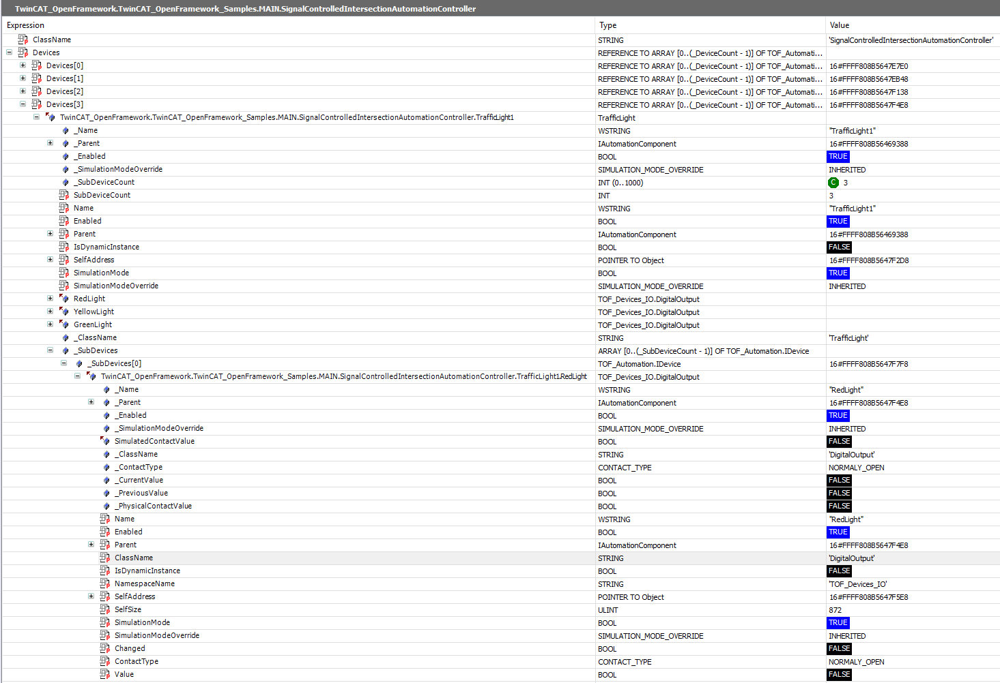

# AutomationEngine Concept (`TOF_Automation`)

## 1. General Description

`TwinCAT.OpenFramework.Automation` (`TOF_Automation`) is a deterministic PLC architectural platform designed to model modular machines and production lines as static component hierarchies. It provides standardized lifecycle control, I/O phase separation, exception and child critical-error policies, synchronous event propagation, action permission checks, simulation contracts, HMI controller plugins, and selective node disabling.

---

## 2. Architecture: `AutomationRunner -> AutomationController -> Branches & Leaves`

At its core, the architecture separates **hardware interaction** (leaves and I/O models) from **technological orchestration** (controllers and composites) using a fixed, constructor-bound hierarchy of static function blocks.

---

## 3. Core Entities

### 3.1. `AutomationRunner`

The cyclic orchestrator at the application task boundary (`TOF_Automation.AutomationRunner`):

* Accepts a persistent array of root `IAutomationComponent` interfaces in `FB_init(components := ...)` (bounds and order remain fixed for its lifetime).
* Drives initialization and cyclic execution across one owning task (`Execute()` takes no arguments; nested runner calls are unsupported).
* Runs `TOF_Core.System.Execute()`, services `TOF_Core.LogManager.ExecuteCurrentTaskLogger()`, checks the global out-of-memory flag via `DynamicMemoryManager.RaiseIfAllocationFailed()`, and cleans up temporary exceptions and auto-disposed objects at the end of every cycle.
* States (`AUTOMATION_RUNNER_STATE`): `INITIALIZING`, `RUNNING`, `INVALID` (terminal configuration or root-initialization failure; reports `InitializationErrorMessage`).

### 3.2. `AutomationComponent`

The abstract base class for all nodes (`TOF_Automation.AutomationComponent` extending `TOF_Core.Object`):

* Operational states (`OPERATIONAL_STATE`):
  * `INITIALIZING` — initial state after PLC start; runs dependency validation and `Initialize()` until ready or timeout (`InitializationTimeout`; `T#0S` resolves immediately to `Parameters.InitializationTimeout`).
  * `WORKING` — normal cyclic execution state after successful initialization.
  * `STOPPED` — entered via `Stop(reason)` (transitions `WORKING -> STOPPED` regardless of `Enabled`) or a runtime stop reaction; requires an explicit `Reset()` while `Enabled` to return to `WORKING`.
  * `INVALID` — terminal state entered when mandatory dependencies, topology validation, or initialization fail.
* **Safe recovery**: if a component's own reset step (`OnReset`, `OnBeforeChildrenReset`, `OnAfterChildrenReset`) or automatic recovery step (`OnRecover`) throws an error, the component always records a `CRITICAL` error and stays in (or moves to) `STOPPED` — it does not ask `ExceptionHandlingPolicy` whether to ignore it.
* **Events**: synchronous borrowed `BroadcastEvent` (top-down) and `BubbleEvent` (bottom-up) work regardless of `Enabled` or operational state; `stopPropagation` halts further routing on the current branch.

### 3.3. `BranchAutomationComponent`

Base class for nodes that coordinate children (`IParentAutomationComponent`):

* **`AutomationController<N>`** — top-level machine or unit root (`Children` array of size `N`; `N = 0` empty compositions are valid on TwinCAT 3.1 Build 4026). Supports `IAutomationControllerPlugin` plugins (e.g., `HmiAutomationComponentElement`) whose `OnBeforeControllerExecute` / `OnAfterControllerExecute` cycle-service hooks continue running in `WORKING` and `STOPPED` even when `Enabled = FALSE`. Overrides `OnBeforeExecute` / `OnAfterExecute` to drive enabled child `ProcessInput` and `ProcessOutput` phases.
* **`CompositeAutomationComponent<N>`** — intermediate sub-machine node (requires a live constructor-bound `Parent`). Groups child devices into a reusable unit and forwards `ProcessInput` / `ProcessOutput` / `BubbleEvent`.
* Validates non-null slots, matching `Parent` references, and slot uniqueness before running initialization hooks; invokes `OnAfterChildrenInitializing` (via `AND_THEN`) only after all children finish initializing, and expands its effective `InitializationTimeout` to at least the maximum child timeout.
* Handles critical errors from children via `IChildCriticalErrorHandlingPolicy` (`SetErrorAndStop`, `SetErrorAndContinue`, `Ignore`) and hierarchical `IActionPermissionPolicy` requests (`RequestActionPermission`). Under `SetErrorAndContinue`, the branch retains its copied non-critical error without invoking `OnRecover` until no enabled child holds an active critical error.

### 3.4. `LeafAutomationComponent`

Terminal node (`IChildAutomationComponent`, mandatory constructor-bound `Parent`, no children):

* `InputLeafAutomationComponent` (`ProcessInput` / `OnProcessInput`)
* `OutputLeafAutomationComponent` (`ProcessOutput` / `OnProcessOutput`)
* `InputOutputLeafAutomationComponent` (both phases)
* Concrete I/O devices (`DigitalInput`, `DigitalOutput`, `AnalogInput`, `AnalogOutput`) live in `TwinCAT.OpenFramework.Devices.IO` (`TOF_Devices_IO`). Simulation contracts (`ISimulatable`, `IConfigurableSimulatable`, `IChildSimulatable`, `IChildConfigurableSimulatable`, `SIMULATION_MODE_OVERRIDE`) are implemented by device classes where needed.

---

## 4. Recursive Composition & Static Storage via `VAR_GENERIC CONSTANT`

Composites and controllers parameterize child capacity with `VAR_GENERIC CONSTANT _ChildCount : TOF_Core.INT_LENGTH := 0`:

* Child arrays (`ARRAY [0.._ChildCount - 1] OF IChildAutomationComponent`) are sized at compile time (including empty `N = 0` on Build 4026) with zero runtime heap allocation.
* Each child receives its `Parent` in `FB_init` and occupies a single fixed slot in its parent's `Children` array.
* Components can be nested as deeply as your machine design requires, limited only by the PLC task's call stack and cycle time.

---

## 5. Static Automation vs. Dynamic Workflow

* Use **`AutomationController` + typed `ENUM` state machines + `Tasks`** for fixed physical equipment, deterministic cycle-by-cycle I/O control, and HMI supervision.
* Use **`TOF_Workflow.Workflow`** when executing variable, externally configured recipes or sequences (including configurations loaded from JSON at runtime). See [Workflow Construction Guide](../../Guides/WorkflowConstruction.md).

---

## 6. Hierarchy Diagram & Example

Complete demo application: `TwinCAT.OpenFramework.Samples` (`Intersection` and `Workflow`).
Walkthrough: [Signal-Controlled Intersection Demo Guide](../../Guides/SignalControlledIntersectionDemo.md).
