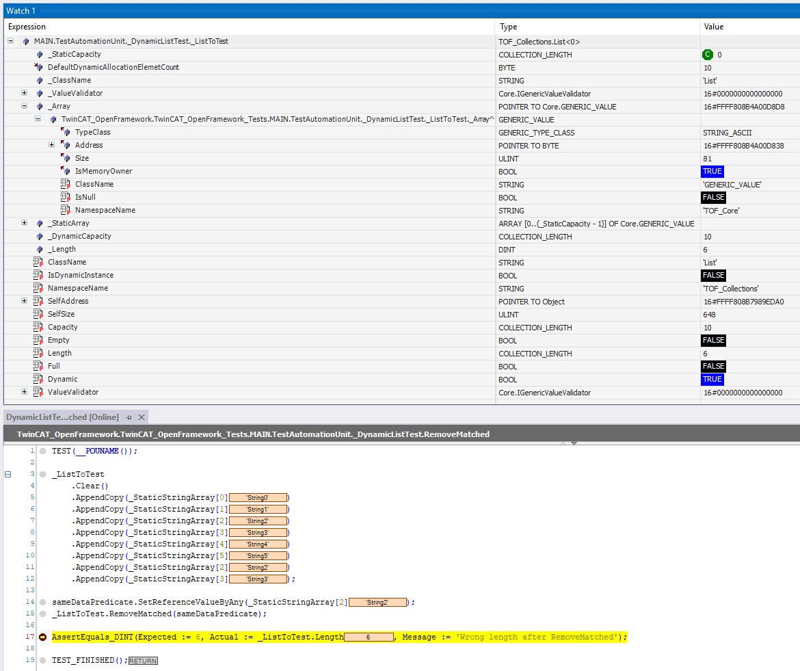

# Collections Concept

## 1. General Description

Collections are abstract data types that allow you to store, organize, and manipulate a group of objects as a single entity.

## 2. Built-in Language Options

The StructuredText language provides two basic ways to work with collections:
1. Arrays  
2. Pointers  

Both approaches have significant limitations. The `TwinCAT_OpenFramework_Collections` module is designed to overcome these limitations and provide a safer and more convenient way to work with collections.

## 3. Limitations of Arrays and Pointers

1. Arrays have a fixed size and are not suitable when the amount of data is unknown in advance.  
2. Pointers allow working with both static and dynamic data, but type safety and memory management are entirely the developer’s responsibility.  
3. Pointer misuse can easily lead to controller crashes or system instability.  
4. Manual memory management often leads to memory leaks, which can eventually stop the controller.  
5. Implementing collection classes manually is complex and time-consuming.  
6. Arrays and pointers do not provide common insertion, equality-search or disposal policies.  

## 4. Standard Library Solutions

Some standard libraries provide basic collection-like structures, such as:
- `Tc2_Utilities.FB_MemRingBuffer`  
- `Tc2_Utilities.FB_HashTableCtrl`  

These building blocks expose their own storage and API contracts; callers must manage the required buffers and lifetimes.

## 5. What `TwinCAT_OpenFramework_Collections` Provides

The framework provides ByteList, List, Dictionary, UniqueDataSet, Queue and Stack.

All collections are universal and store values using the `GENERIC_VALUE` type (except ByteList). 

`GENERIC_VALUE` concept described [here.](../Generics/GenericsConcept.md)

## 6. Static and Dynamic Collections

Collections can be either static or dynamic:

- A collection is **static** if the `VAR_GENERIC CONSTANT` parameter is greater than zero.  
- A collection is **dynamic** if the `VAR_GENERIC CONSTANT` parameter is set to zero.  

The maximum number of elements a collection can hold is available via the `Capacity` property.  
The actual number of stored elements is available via the `Length` property.

- For static collections, `Capacity` is defined at declaration time.  
- For dynamic collections, `Capacity` grows as needed.  

## 7. Key Features

- Each element is stored as a `GENERIC_VALUE` (except `ByteList`).  
- A single collection can store values of different types.  
- Custom validation rules can be applied using `TOF_Core.IGenericValueValidator`.  
- Memory management can be delegated to the collection, allowing automatic cleanup when elements are removed.  
- All collections implement the `IEnumerable` interface, enabling iteration using a `WHILE` loop.  

## 8. Supported Collection Types

### 8.1. ByteList
A collection optimized for working with bytes.  
Supports: add (various), clear, replace (various), remove, search, get by index.

### 8.2. List
A collection of `GENERIC_VALUE`.  
Supports: add, clear, replace, insert, remove, search, get by index, sort.

### 8.3. Dictionary
A key-value collection where both key and value are `GENERIC_VALUE`.  
Keys are unique.  
Supports: assign, clear, remove, search by key, get value or index by key, get by index.

### 8.4. UniqueDataSet
A collection of unique `GENERIC_VALUE` items.  
Supports: assign, clear, remove, search, get by index.

### 8.5. Queue
A FIFO (first-in, first-out) collection of `GENERIC_VALUE`.  
Supports standard queue operations such as enqueue, peek, remove first and clear.

### 8.6. Stack
A LIFO (last-in, first-out) collection of `GENERIC_VALUE`.
Index zero and enumeration start at the top. Push adds a value; Peek borrows the top;
RemoveLast destroys the stored entry without transferring ownership to the caller.

## 9. Ownership and borrowed views

Copy methods prepare independently owned payloads. Object copying requires `ICloneable`;
copying ordinary data is shallow and does not recursively clone pointer or interface fields.
Generic insertion transfers disposal responsibility for an owning descriptor on success.
Reset the caller's descriptor after transfer; do not release it as a second owner.
Insertion failure before acceptance leaves disposal responsibility with the caller.

Get, Peek, FindSingle, TryGet and enumerator Current return borrowed data. Their descriptor
may retain `IsMemoryOwner = TRUE`; this does not grant the consumer permission to release it.
Keep the collection and its borrowed source storage alive. Mutation can invalidate views.
All six collection FBs use `no_assign`: the compiler rejects whole-instance assignment, which would copy
backing pointers and ownership without cloning them. Interface assignment still borrows the same instance.

Dictionary keeps the existing equal key and replaces its value. UniqueDataSet replaces
the matching descriptor. Neither container promises sorted positions or enumeration order.
Keys and set elements must keep equality/hash-relevant data stable while stored; remove
them before changing that data. A custom equality comparer is borrowed for the collection
lifetime and must provide matching equality and hash results.

Generic query arguments are borrowed by default in Dictionary and UniqueDataSet.
List, Queue and Stack ContainsGeneric default to releasing their query. Pass the release
argument explicitly when borrowing a descriptor. A releasing query must not own storage
still retained by the collection; caller-side aliases are not reset by the call.

## 10. Sorting

List.Sort uses `GENERIC_VALUE.CompareTo` when the comparer is omitted or zero. This default
supports the Core natural order for compatible numeric, text, temporal and OBJECT values.
Mixed numeric widths and STRING/WSTRING pairs do not require choosing a typed comparer.
OBJECT values require `IComparable`; unsupported pairs raise `GenericConversionNotSupportedException`.
An explicitly supplied comparer takes precedence and defines its own supported representations.

Empty and singleton lists return without comparing. Comparison failure can leave the order
partially changed, while preserving every descriptor and its ownership. A default comparer
is not inferred from the first entry's type.

## 11. Enumeration and failures

CreateEnumerator allocates an independent cursor owned by the caller. Release it explicitly
through `TOF_Core.Memory.TryReleaseDynamicObject` after converting its interface to `IObject`.
Keep the source alive and structurally unchanged throughout traversal. Current is empty
before the first successful MoveNext, after Reset and after exhaustion.
Repeated exhausted MoveNext calls return FALSE until Reset for an unchanged source.
A cursor constructed with a null source reports `DataMemberNotSpecifiedException` when
MoveNext or a current-value getter is used. Initialization does not throw for that configuration.

One task drives each collection instance. Cross-task access and reentrant mutation from
callbacks require an explicitly supported contract; the containers provide no internal locking.
Try methods contain failures and retain the fatal allocation latch. Each task must call
`TOF_Core.DynamicMemoryManager.RaiseIfAllocationFailed` outside recoverable handlers at
its task boundary; AutomationRunner provides that boundary for the tasks it runs.

Static capacity bounds storage, but Copy, CreateEnumerator and error construction can
still allocate. Dynamic growth can fail terminally. FB_init does not invoke validators,
comparers or throwing validation. Preserving live contents and cursors across online
change requires separate target verification; address-based hash indices must be discarded
and populated again after equality-relevant address relocation.

## 12. Usage

## 13. Tests

`Sources/TwinCAT.OpenFramework.Tests/Tests/Collections/` contains the existing TcUnit suites
and `Contract/CollectionsContractTest`. New contract regressions cover callback failure
cleanup, ownership, hash collisions and growth, and independent cursors. Their source
registration does not establish successful compilation or runtime results.
