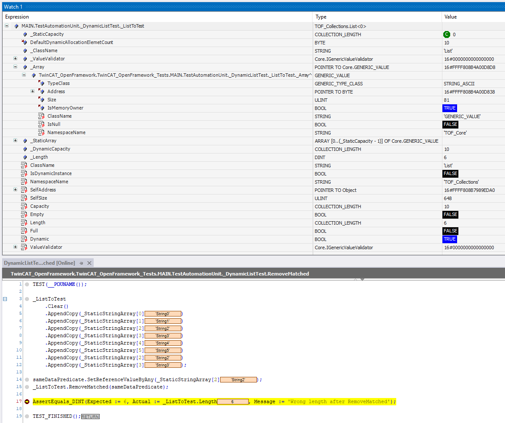

# Collections Concept

## 1. General Description

Collections are containers that let you store, search, sort, and loop over a group of items together (such as a list of recipes, a queue of messages, or a lookup table).

## 2. Built-in Language Options

Structured Text provides two basic ways to work with multiple items:
1. Arrays  
2. Pointers  

Both approaches have significant limitations. `TwinCAT_OpenFramework_Collections` makes working with groups of items safer and much easier.

## 3. Limitations of Arrays and Pointers

1. Arrays have a fixed size and cannot grow when you do not know the number of items in advance.  
2. Pointers can handle both fixed and dynamic memory, but type safety and freeing memory are completely up to you.  
3. A wrong pointer easily crashes the PLC.  
4. Forgetting to free dynamic memory causes memory leaks that can eventually stop the controller.  
5. Writing lists, queues, or lookup tables by hand takes a lot of code and testing.  
6. Raw arrays and pointers give you no built-in way to insert, search, sort, or automatically free removed items.  

## 4. Standard Library Solutions

Standard Beckhoff libraries include a few basic helpers such as:
- `Tc2_Utilities.FB_MemRingBuffer`  
- `Tc2_Utilities.FB_HashTableCtrl`  

With these blocks, you still have to allocate and manage the underlying byte buffers and memory lifetimes yourself.

## 5. What `TwinCAT_OpenFramework_Collections` Provides

The framework provides `ByteList`, `List`, `Dictionary`, `UniqueDataSet`, `Queue`, and `Stack`.

Except for `ByteList`, all of them can hold any PLC data type through `GENERIC_VALUE`. 

See the [`GENERIC_VALUE` Concept](../Generics/GenericsConcept.md) for details.

## 6. Static and Dynamic Collections

Every collection can work in either fixed-size (static) mode or growable (dynamic) mode:

- **Static (`<N>` > 0, e.g. `List<10>`):** stores up to `N` items in fixed memory created at compile time (no heap allocation when adding items).  
- **Dynamic (`<0>`, e.g. `List<0>`):** starts small and grows automatically using dynamic memory as you add more items.  

`Capacity` shows how many items fit right now, and `Length` shows how many items are currently stored:

- For static collections, `Capacity` stays fixed at the size you chose.  
- For dynamic collections, `Capacity` increases automatically as needed.  

## 7. Key Features

- Each element is stored as a `GENERIC_VALUE` (except `ByteList`).  
- A single collection can store values of different types.  
- Custom validation rules can be applied using `TOF_Core.IGenericValueValidator`.  
- Memory management can be delegated to the collection, allowing automatic cleanup when elements are removed.  
- All collections implement the `IEnumerable` interface, enabling iteration using a `WHILE` loop.  

## 8. Supported Collection Types

### 8.1. ByteList
A collection optimized for working with bytes.  
Supports: add (various), clear, replace (various), remove, search, get by index.

### 8.2. List
A collection of `GENERIC_VALUE`.  
Supports: add, clear, replace, insert, remove, search, get by index, sort.

### 8.3. Dictionary
A key-value collection where both key and value are `GENERIC_VALUE`.  
Keys are unique.  
Supports: assign, clear, remove, search by key, get value or index by key, get by index.

### 8.4. UniqueDataSet
A collection of unique `GENERIC_VALUE` items.  
Supports: assign, clear, remove, search, get by index.

### 8.5. Queue
A FIFO (first-in, first-out) collection of `GENERIC_VALUE`.  
Supports standard queue operations such as enqueue, peek, remove first and clear.

### 8.6. Stack
A LIFO (last-in, first-out) collection of `GENERIC_VALUE`.
Index `0` (and iteration) starts at the top of the stack. `Push` adds an item on top, `Peek` lets you read the top item without removing it, and `RemoveLast` removes and cleans up the top item directly instead of handing ownership back to you.

## 9. Ownership and reading items safely

When a collection stores a `GENERIC_VALUE` with `IsMemoryOwner = TRUE`, the collection takes care of freeing that item's dynamic memory when the item is removed or the collection is cleared.

* **Copying (`Copy`):** Makes an independent copy of stored items. To copy an `OBJECT`, it must implement `ICloneable`. Plain variables and structs are copied byte-by-byte, so pointer or interface fields inside them are not cloned separately.
* **Giving ownership on insert:** Passing an owning `GENERIC_VALUE` (`IsMemoryOwner = TRUE`) to a generic insert/add method transfers ownership to the collection when adding succeeds. Call `Reset()` on your local wrapper afterward so you do not free the same memory twice. If inserting fails before the item is added, you still own that memory.
* **Reading (`Get`, `Peek`, `FindSingle`, `TryGet`, `Current`):** These return a direct reference to the item still inside the collection — do **not** call `Release()` on it even if `IsMemoryOwner` says `TRUE`. Keep the collection (and any external caller variables referenced inside it) alive while reading, because modifying or clearing the collection can make that reference invalid.
* **No direct variable copying (`colA := colB`):** All six collection function blocks prevent direct assignment between variables (`no_assign`), because copying raw bytes would share internal pointers without cloning the elements. Assigning a collection to an interface variable still points to that same collection.
* **`Dictionary` & `UniqueDataSet` keys:** `Dictionary` keeps the existing key and replaces only its value; `UniqueDataSet` replaces the matching item. Neither keeps items in sorted order. Do not edit fields of a key or set item that change its equality or hash code while it is inside the collection — remove it first, change it, then add it back. If you pass a custom comparer, keep it alive for the collection's lifetime and make sure equal items return the same hash code.
* **Search arguments:** In `Dictionary` and `UniqueDataSet`, lookup keys are only read and never freed. In `List`, `Queue`, and `Stack`, `ContainsGeneric` frees an owning search wrapper (`IsMemoryOwner = TRUE`) by default — pass the release flag as `FALSE` if you want to keep owning it. Never pass an owning search wrapper that points to memory already owned inside the collection, and note that releasing inside the call does not clear other local variables holding that same pointer.

## 10. Sorting

Calling `List.Sort` without a custom comparer (or passing `0`) uses `GENERIC_VALUE.CompareTo` by default. This handles numbers (even when mixing different numeric types such as `INT` and `LREAL`), text (`STRING` and `WSTRING`), dates/times, and `OBJECT` values implementing `IComparable`. Comparing incompatible types throws `GenericConversionNotSupportedException`. Passing your own `IComparer` overrides this default order.

Empty and 1-item lists return right away without comparing anything. If comparing two items throws an error mid-sort, the list order may stay partially sorted, but every element and its memory ownership remain intact. A default comparer is never guessed from the first element's type.

## 11. Iterators (`CreateEnumerator`) and errors

* **Creating and freeing an iterator:** `CreateEnumerator()` allocates a cursor object in dynamic memory. When you finish iterating, convert its interface to `IObject` and free it with `TOF_Core.Memory.TryReleaseDynamicObject`. Keep the collection alive and do not add or remove items while looping through it. `Current` is empty before the first successful `MoveNext`, after `Reset`, and after reaching the end (further `MoveNext` calls keep returning `FALSE` until `Reset`). If an iterator was created with a null collection, `FB_init` succeeds without throwing, and calling `MoveNext` or reading `Current` throws `DataMemberNotSpecifiedException`.
* **One PLC task per collection:** Collections have no built-in locks, so use each instance from one PLC task only. Do not modify a collection from inside a user callback while an operation on that same collection is running.
* **`Try` methods and running out of memory:** `Try` methods catch errors and return `FALSE`. If dynamic memory runs out (`__NEW` fails), `DynamicMemoryManager` sets a global out-of-memory flag; `Try` methods keep that flag set and return `FALSE`. Every PLC task must call `TOF_Core.DynamicMemoryManager.RaiseIfAllocationFailed()` at the end of each cycle outside recovery blocks so the program stops safely instead of running in a broken state (`AutomationRunner` does this automatically).
* **Static vs. dynamic memory & online change:** Using static size (`N > 0`) avoids heap allocations when adding items, though `Copy`, `CreateEnumerator`, and error messages can still allocate memory; dynamic growth fails with an out-of-memory error when memory is full. `FB_init` never throws or calls validators or comparers. If live `Dictionary` or `UniqueDataSet` instances survive an online change where variable addresses move, rebuild hash indices that depend on object addresses.

## 12. Usage

## 13. Tests

Unit and contract tests for collections live in
`Sources/TwinCAT.OpenFramework.Tests/Tests/Collections/` (including
`Contract/CollectionsContractTest`), covering ownership rules, callback failures,
hash collisions, dynamic growth, and independent enumerators.
