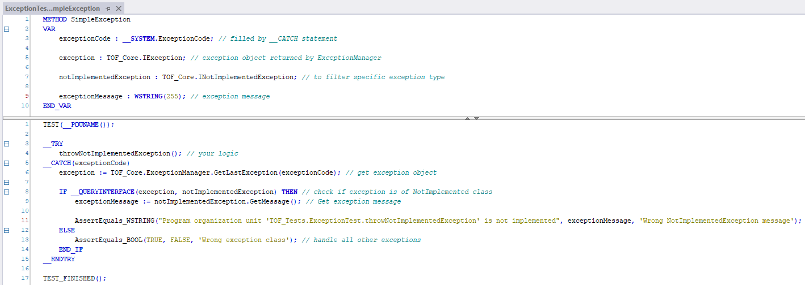
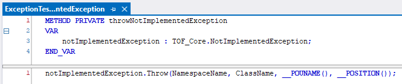
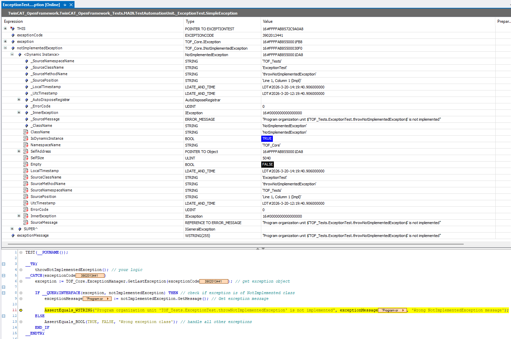

# `__TRY -> __CATCH -> __FINALLY` Usage Concept

## 1. General Description

Using `__TRY -> __CATCH -> __FINALLY -> __ENDTRY`, you can execute a block of code, handle an exception, and run finalization logic. An exception interrupts the remaining statements in the `__TRY` block; catching it does not undo earlier state changes.

### Important Notes

1. Catching a runtime error does not prove that the application state remains valid. Do not use exception handling as a substitute for valid pointers, correct ownership or resource cleanup.

2. Inside `__CATCH`, you can retrieve an error code.
   This is simply a numeric value. Some error codes are predefined and described in the `__SYSTEM.ExceptionCode` enumeration.

3. You can create custom exceptions and raise them using the `Tc2_System.F_RaiseException` function.

4. The construct `__TRY -> __FINALLY -> __ENDTRY` **without** a `__CATCH` block is currently not supported.

5. If another exception occurs inside `__CATCH`, its `__FINALLY` block is **not executed**. This is documented TwinCAT behavior; do not assume that a future runtime version will change it. See [Beckhoff's exception-handling documentation](https://infosys.beckhoff.com/content/1033/tc3_plc_intro/2529187211.html).

6. Before allowing execution to continue after an exception, define which component state and results remain valid. A handling policy selects a reaction; it does not roll back a partially completed operation.

---

## 2. Usage in OpenFramework

The standard mechanism only provides an error code (numeric), which is often insufficient.

This framework extends the default behavior to include additional contextual information:

### Extended Exception Data

Each exception can carry:

1. A textual error message
2. A numeric error code
3. Supplied error location (namespace, class, POU and source position)
4. Timestamp (both local time and UTC)
5. Exception class (useful for filtering)

Native errors are represented by `SystemException`. Their original throw location is not available through this wrapper; the catch point is recorded separately. A native error code already lost by the runtime cannot be reconstructed by the framework.

---

## 3. Core Concepts

To support this functionality, several internal components are implemented. Below is a simplified overview:

### 3.1 Exception Class

A dedicated class used to describe errors. Has many descendants for specific exception types.

* Contains a `Throw` method used to raise an exception

---

### 3.2 Exception Manager

Transports exceptions within the current cyclic PLC task:

* Stores the last framework payload separately for each task
* Returns that payload or a task-local native wrapper from `GetLastException`
* Propagates an already obtained exception through `Throw`; `ReThrowLastException` uses the current catch code and context

The native wrapper is mutable and reused by the next native catch in the same task. Clone a static result before callbacks that may handle another native error. Exception references must not cross task boundaries.

---

### 3.3 System and Timestamps

* `TOF_Core.System.Execute()` updates the calling task's cached time
* Wait for `SystemDataValid` before using that time
* Framework exceptions capture cached timestamps on `Throw`; native wrappers capture them on `GetLastException`
* Cloning preserves the captured timestamps

---

### 3.4 Dynamic Memory Manager

* Static exception templates are cloned on propagation so that handlers can use them outside the original scope
* `Clone` creates the dynamic object, checks allocation, explicitly registers it with `DynamicMemoryManager.RegisterAutoDisposedObject`, then copies its payload
* Plain `__NEW` does not transfer ownership to the manager
* The manager releases registered instances when the owning task calls cleanup after all consumers
* Registration ignores a repeated registration of the same object; it does not compare exception contents or merge equivalent errors

Do not retain exception references beyond their task's cleanup, delete registered instances manually or pass them to another task. Copy diagnostics into an `ERROR` value when they must survive across cycles; `ToError` copies data without retaining an exception reference.

For a custom exception, ensure that `Clone` preserves its concrete type and all added payload. An inherited `Clone` is not automatically suitable. Follow the existing concrete exception's registration sequence, and keep lifecycle methods (`FB_init`, `FB_exit`, `FB_reinit`) free of exception creation and raising.

---

## 4. How to Use

To use the exception mechanism, you need to implement two parts:

### 4.1 Exception Handling Point

Use a `__TRY -> __CATCH` block and obtain the exception with `GetLastException`. The complete example below shows the current call arguments and task cleanup. The images illustrate the concept; use the text example for current API calls.



---

### 4.2 Exception Throwing Point

Your business logic where exceptions may be raised.



---

## 5. Example without AutomationRunner

Call this program from a cyclic PLC task. Setting `requestException` raises one demonstration exception after system time becomes available. The request is cleared before throwing; no machine operation is partially executed. `lastError` retains copied diagnostics until explicitly cleared or replaced.

Declaration:

```iecst
(*! <summary>Demonstrates a cycle-scoped exception and persistent diagnostic copy.</summary> *)
PROGRAM MAIN
VAR
	requestException : BOOL;
	demoException : TOF_Core.StandardException;
	exceptionCode : __SYSTEM.ExceptionCode;
	caughtException : TOF_Core.IException;

	lastError : TOF_Core.ERROR;
END_VAR
```

Implementation:

```iecst
TOF_Core.System.Execute();

IF TOF_Core.System.SystemDataValid THEN
	__TRY
		IF requestException THEN
			requestException := FALSE;

			demoException.Throw(
				sourceNamespaceName := '',
				sourceClassName := '',
				sourcePOUName := __POUNAME(),
				sourcePosition := __POSITION(),
				message := "Demonstration exception",
				errorCode := 0,
				innerException := 0
			);
		END_IF
	__CATCH(exceptionCode)
		caughtException := TOF_Core.ExceptionManager.GetLastException(
			exceptionCode := exceptionCode,
			catchPointNamespaceName := '',
			catchPointPOUName := __POUNAME(),
			catchPointPosition := __POSITION()
		);

		caughtException.ToError(lastError, TOF_Core.ERROR_SEVERITY.ERROR);
	__ENDTRY
END_IF

caughtException := 0;

TOF_Core.DynamicMemoryManager.RaiseIfAllocationFailed();

TOF_Core.ExceptionManager.Cleanup();
TOF_Core.DynamicMemoryManager.CleanupMemory();
```

Run the final three calls after all exception consumers in each task, outside handlers that swallow terminal errors. `RaiseIfAllocationFailed` re-raises a latched terminal allocation failure even if an earlier handler caught it. Cleanup does not clear that latch, and execution must not continue into subsequent cycles after terminal OOM. Diagnostic formatting, including `ToError`, can itself encounter allocation failure.

`AutomationRunner.Execute()` already updates system services and performs this epilogue on its normal completion path. Its cleanup is the lifetime boundary for exceptions consumed during that call; call the runner outside handlers that swallow terminal errors.

---

## 6. Result



---

## 7. Example

```text
TwinCAT_OpenFramework_Tests -> ExceptionTest -> SimpleException
```
