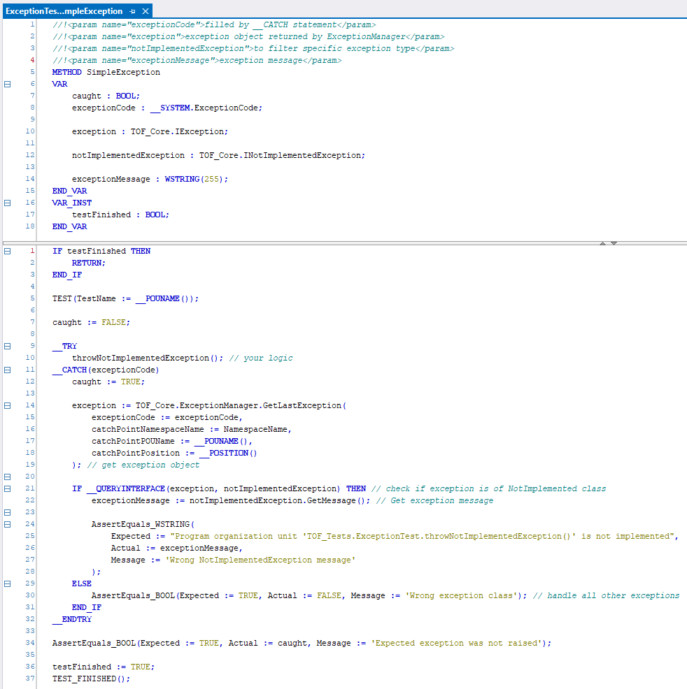
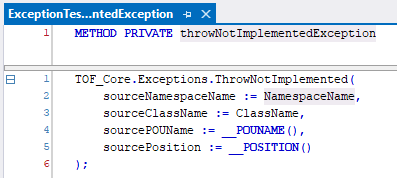
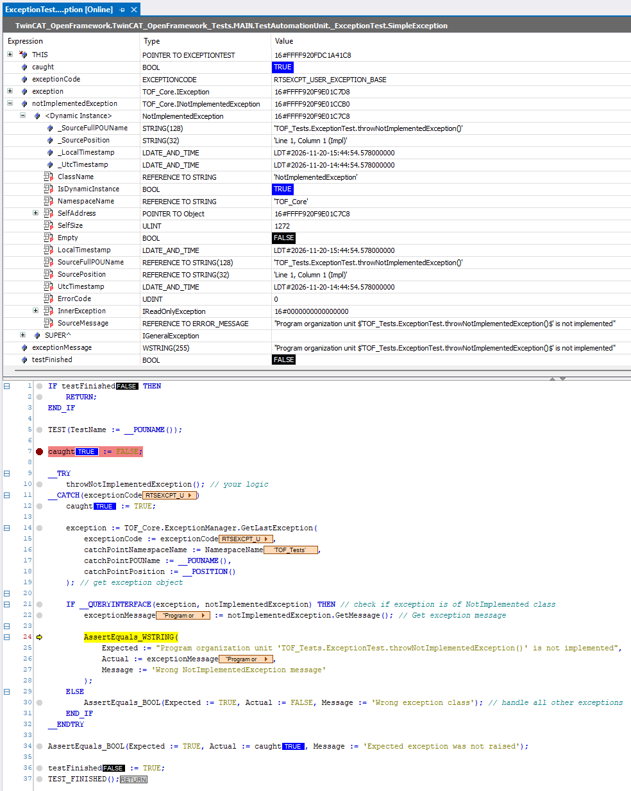

# `__TRY -> __CATCH -> __FINALLY` Usage Concept

## 1. General Description

Using `__TRY -> __CATCH -> __FINALLY -> __ENDTRY`, you can execute a block of code, handle an exception, and run finalization logic. An exception interrupts the remaining statements in the `__TRY` block; catching it does not undo earlier state changes.

### Important Notes

1. Catching an error does not automatically fix broken data. Always check your pointers, clean up resources, and make sure your machine state is safe before continuing.

2. Inside `__CATCH`, you can retrieve an error code.
   This is simply a numeric value. Some error codes are predefined and described in the `__SYSTEM.ExceptionCode` enumeration.

3. You can create custom exceptions and raise them using the `Tc2_System.F_RaiseException` function.

4. The construct `__TRY -> __FINALLY -> __ENDTRY` **without** a `__CATCH` block is currently not supported.

5. If another exception occurs inside `__CATCH`, its `__FINALLY` block is **not executed**. This is documented TwinCAT behavior; do not assume that a future runtime version will change it. See [Beckhoff's exception-handling documentation](https://infosys.beckhoff.com/content/1033/tc3_plc_intro/2529187211.html).

6. Catching an error (or letting an error-handling policy decide how to react) does not undo half-finished work. Make sure your component is left in a safe, known state before continuing.

7. The compiler does **not** perform stack unwinding when an exception is thrown: if an exception leaves a method, `FB_exit` is **not** called for local function blocks declared inside that method (or in intermediate methods on the call stack). Do not rely on `FB_exit` of method-local function blocks to free memory, handles, or other resources on code paths that can throw — keep resource-owning objects in FB/PROGRAM fields or clean them up explicitly. This is a permanent limitation of the CODESYS compiler (`Won't Fix`; see [CODESYS ticket CDS-94841 in the CODESYS V3.5 SP22 Release Notes](https://api-www.codesys.com/fileadmin/user_upload/CODESYS_Group/Ecosystem/Up-to-Date/Releases-Lifecycle/Release-Updates/Release-Notes/Release_Notes_CODESYS_35220.html)).

---

## 2. Usage in OpenFramework

### When to Use Exceptions

Exceptions are meant for real errors that stop an operation from finishing — not for every ordinary "no" or "not found" result.

Follow these simple rules:

* **Use return values or states for normal outcomes.** For example, when an optional item is missing, an operation is still in progress, or a `Try` method returns `FALSE`. Never throw an exception just to catch it right away and turn it into `FALSE` or a status code.
  For example, if a removal method promises that a value will be absent, it can do nothing when the value is already absent, even in an empty collection. Document this behavior at the method declaration.
* **Use exceptions when a method cannot do its job.** For example, when a required input is missing or out of range and the method has no normal way to report failure.
* **Only catch an exception when you actually do something with it.** Good reasons to catch are recovering safely, cleaning up resources, recording error details, adding context before rethrowing, or keeping a `Try` method from throwing. Remember: catching an error does not undo changes that already happened before the error.

Keep three safety rules in mind:

* **`Try` methods never throw.** Even if something inside a `Try` method fails (including nested calls or user callbacks), the method must catch the error and return `FALSE` instead of letting an exception escape.
* **Lifecycle methods (`FB_init`, `FB_exit`, `FB_reinit`) never throw.** Do not create or throw exceptions inside them.
* **Running out of memory stops the program.** If the PLC runs out of dynamic memory (when `__NEW` fails), `DynamicMemoryManager` sets a global out-of-memory flag. A `Try` method still returns `FALSE` without clearing that flag, and `DynamicMemoryManager.RaiseIfAllocationFailed()` at the end of the cycle raises the error outside normal `__TRY`/`__CATCH` recovery blocks so the program does not keep running in a broken state on the next PLC cycle.

### What the Framework Adds

The standard mechanism only provides an error code (numeric), which is often insufficient.

This framework extends the default behavior to include additional contextual information:

### Extended Exception Data

Each exception can carry:

1. A textual error message (`ERROR_MESSAGE`, capacity configured by `TOF_Core.Parameters.ERROR_MESSAGE_WIDE_CHAR_SIZE`, default 500 wide characters)
2. A numeric error code
3. Supplied error location (namespace, class, POU and source position)
4. Timestamp (both local time and UTC)
5. Exception class (useful for filtering)

Built-in TwinCAT runtime errors (such as divide-by-zero or null pointer access) are wrapped in `SystemException`. TwinCAT does not provide the original throw line for these errors, so the framework records where the error was caught instead.

---

## 3. Core Concepts

To support this functionality, several internal components are implemented. Below is a simplified overview:

### 3.1 `Exception` Class & `TOF_Core.Exceptions` Facade

A dedicated base class (`Exception`) used to describe errors, with specialized descendants (`StandardException`, `ArgumentNotSpecifiedException`, `ArgumentOutOfRangeException`, `DataMemberNotSpecifiedException`, `NullReferenceException`, `AggregateException`, etc.).

* **Direct throwing:** You can declare a local (or FB-level) exception variable — such as `StandardException`, `AggregateException`, or your own custom exception class — and call `.Throw(...)` directly on it. The message is formatted without dynamic string builders, and `ExceptionManager.Throw` clones the exception via `__NEW` so it survives until `__CATCH` reads it.
* **`TOF_Core.Exceptions` facade (saves PLC stack space):** Each exception object holds an `ERROR_MESSAGE` buffer (~1 KB by default). Declaring several local exception variables inside a regular method reserves that stack space on *every* normal call, even when no error happens. Calling `TOF_Core.Exceptions.Throw*` (such as `ThrowStandard`, `ThrowArgumentNotSpecified`, `ThrowArgumentOutOfRange`, `ThrowDataMemberNotSpecified`, `ThrowNullReference`) keeps 0 bytes of exception variables on your method's stack — the temporary exception is created inside the helper only when an error actually occurs.

---

### 3.2 Exception Manager

Handles passing exceptions inside the current cyclic PLC task:

* Saves the active framework exception separately for each PLC task
* Returns that exception — or a task-local `SystemException` — from `GetLastException`
* Passes along an existing exception via `Throw`; `ReThrowLastException` captures the current catch point and rethrows it

How references behave if you hold on to one:

* **Framework exceptions** get a fresh dynamic copy via `__NEW` on each `Throw`. If you hold an `IException` reference to one framework exception and another framework exception is thrown in the same cycle, the first one is **not** overwritten (it stays valid until `DynamicMemoryManager.CleanupMemory()`).
* **Built-in TwinCAT runtime errors** (such as divide-by-zero or null pointer access) do **not** call `__NEW` in `GetLastException`; instead, each task reuses one shared static `SystemException` instance. Because of that, catching another built-in error in the same task overwrites the fields of that shared object. If you need to keep the first system error before calling code that might catch another one, copy it into an `ERROR` (`ToError`) or call `Clone()`.

Never pass exception references to another PLC task.

---

### 3.3 System and Timestamps

* `TOF_Core.System.Execute()` updates the calling task's cached time
* Wait for `SystemDataValid` before using that time
* Framework exceptions record the time when `Throw` is called; built-in TwinCAT errors (`SystemException`) record the time when `GetLastException` catches them
* Cloning keeps those saved timestamps intact

---

### 3.4 Dynamic Memory Manager

* When an exception is thrown, the framework creates a dynamic copy (`Clone`) so the error survives until a `__CATCH` block reads it.
* Inside `Clone`, the new object is allocated with `__NEW`, checked for out-of-memory, registered via `DynamicMemoryManager.RegisterAutoDisposedObject`, and then filled with the error data. Plain `__NEW` alone does not register the object for automatic cleanup.
* At the end of the task cycle, `DynamicMemoryManager.CleanupMemory()` automatically frees all registered exception objects created in that task.
* Registering the exact same object twice is safely ignored.

Do not keep an `IException` reference after the end-of-cycle cleanup, do not `__DELETE` it manually, and do not pass it to another PLC task. If you need to keep error information for later cycles (for example, to show on an HMI), call `ToError()` to copy it into an `ERROR` (see below).

If you create your own custom exception class with extra fields, override `Clone` so it creates your exact class, registers it with `DynamicMemoryManager.RegisterAutoDisposedObject`, and copies all extra fields. Never create or throw exceptions inside `FB_init`, `FB_exit`, or `FB_reinit`.

---

### 3.5 `Exception` vs. `ERROR` (Event vs. State)

A simple way to think about the difference:

* **`Exception` is an event.** It happens at a specific moment to stop the current operation and jump to a `__CATCH` block. It is temporary and lives only until end-of-cycle cleanup (`DynamicMemoryManager.CleanupMemory()`). Do not store `IException` references across cycles or pass them to another PLC task.
* **`ERROR` is a state.** `TOF_Core.ERROR` (a data function block extending `READ_ONLY_ERROR`) stores copied error details — `Severity`, `TopMessage`, `RootMessage`, `TopSource`, `RootSource`, `LocalTimestamp`, and `UtcTimestamp` (along with `HasError`, `Empty`, `ToString()`, and `Clear()`) — with no reference back to the original exception object. It stays valid across PLC cycles until your code clears or replaces it, making it suitable for component fault state, HMI display, and long-term diagnostics.

In short: throw an **`Exception`** when something goes wrong right now; catch it and call `caughtException.ToError(...)` when you want to keep that failure as an **`ERROR`** state across future PLC cycles.

---

## 4. How to Use

To use the exception mechanism, you need to implement two parts:

### 4.1 Exception Handling Point

Use a `__TRY -> __CATCH` block and obtain the exception with `GetLastException`. The complete example below shows the current call arguments and task cleanup. The images illustrate the concept; use the text example for current API calls.



---

### 4.2 Exception Throwing Point

Your business logic where exceptions may be raised.



---

## 5. Example without AutomationRunner

Call this program from a cyclic PLC task. Setting `requestException` raises one example exception once system time is ready (`requestException` is cleared first so nothing runs twice). `lastError` keeps the saved error details until your code clears or replaces them.

Declaration:

```iecst
(*! <summary>Demonstrates a cycle-scoped exception and persistent diagnostic copy.</summary> *)
PROGRAM MAIN
VAR
	requestException : BOOL;
	demoMessage : TOF_Core.ERROR_MESSAGE := "Demonstration exception";
	exceptionCode : __SYSTEM.ExceptionCode;
	caughtException : TOF_Core.IException;

	lastError : TOF_Core.ERROR;
END_VAR
```

Implementation:

```iecst
TOF_Core.System.Execute();

IF TOF_Core.System.SystemDataValid THEN
	__TRY
		IF requestException THEN
			requestException := FALSE;

			TOF_Core.Exceptions.ThrowStandard(
				sourceNamespaceName := CurrentNamespace.Name, (* name of your project namespace *)
				sourceClassName := ClassName, (* usually property ClassName returns __POUNAME() of the FB or PROGRAM *)
				sourcePOUName := __POUNAME(),
				sourcePosition := __POSITION(),
				message := demoMessage
			);
		END_IF
	__CATCH(exceptionCode)
		caughtException := TOF_Core.ExceptionManager.GetLastException(
			exceptionCode := exceptionCode,
			catchPointNamespaceName := CurrentNamespace.Name,
			catchPointPOUName := __POUNAME(),
			catchPointPosition := __POSITION()
		);

		caughtException.ToError(
			targetError := lastError,
			severity := TOF_Core.ERROR_SEVERITY.ERROR
		);
	__ENDTRY
END_IF

caughtException := 0;

TOF_Core.DynamicMemoryManager.RaiseIfAllocationFailed();

TOF_Core.ExceptionManager.Cleanup();
TOF_Core.DynamicMemoryManager.CleanupMemory();
```

Always run those last three lines at the very end of the PLC task cycle, after all code that reads exceptions, and outside any `__TRY`/`__CATCH` block that ignores errors:

* `RaiseIfAllocationFailed()` checks the global out-of-memory flag. Even if an earlier `Try` method or `__CATCH` block hid the error, this call stops the task instead of letting the program continue in a broken state on the next cycle. Cleanup does not clear that flag.
* `ExceptionManager.Cleanup()` and `DynamicMemoryManager.CleanupMemory()` free the temporary exception objects created during this cycle. (Keep in mind that formatting error text, such as `ToError`, can also fail if memory runs out.)

If you use `AutomationRunner.Execute()`, it already runs `TOF_Core.System.Execute()` and all three end-of-cycle steps automatically. Just call `Runner.Execute()` outside any `__TRY`/`__CATCH` block that swallows errors, and do not keep `IException` references after `Execute()` returns.

---

## 6. Result



---

## 7. Example

```text
TwinCAT_OpenFramework_Tests -> ExceptionTest -> SimpleException
```
