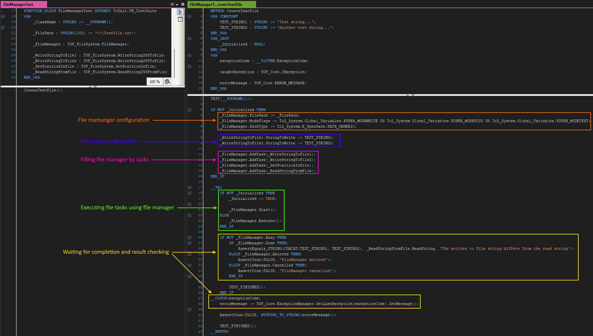
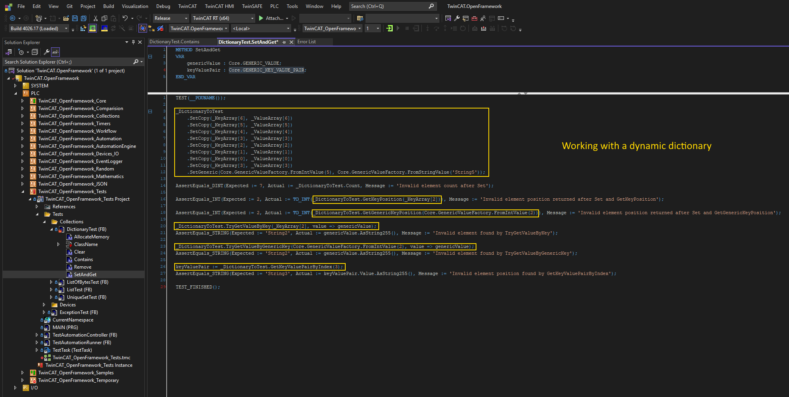
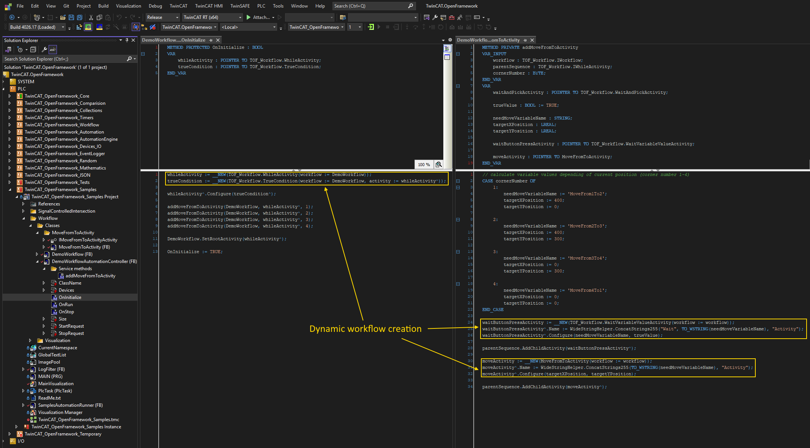

# TwinCAT.OpenFramework: Technical Capabilities

This is an **object-oriented framework** developed for **TwinCAT 3.1 Build 4026+**, providing a set of modular, deterministic libraries for industrial automation (current library release: `1.0.12.0`).

It bridges the gap between traditional PLC programming and modern software engineering, bringing structured OOP abstractions, collections, exception diagnostics, JSON configuration, and automated testing directly into Structured Text.

---

## 🛠️ Core Capabilities

### 1. Enterprise-Grade Automation Architecture
* **Automation Execution Engine (`TOF_Automation`):** `AutomationRunner` manages root components passed to its constructor across `INITIALIZING`, `RUNNING`, and `INVALID` states, automatically running `TOF_Core.System`, task-local logging, out-of-memory checks, and per-task exception cleanup at the end of every cycle. Individual nodes derive from `AutomationComponent` (`OPERATIONAL_STATE`: `INITIALIZING`, `WORKING`, `STOPPED`, `INVALID`) through `BranchAutomationComponent` (`AutomationController<N>`, `CompositeAutomationComponent<N>`) and `LeafAutomationComponent` (`InputLeafAutomationComponent`, `OutputLeafAutomationComponent`, `InputOutputLeafAutomationComponent`). *Concept described [here](Concepts/AutomationEngine/AutomationEngine.md).*
* **Machine Hierarchy, Policies & HMI:** Static component trees enforce single-slot ownership and mandatory constructor-bound parents, with synchronous `BubbleEvent` / `BroadcastEvent` propagation, hierarchical `IActionPermissionPolicy` checks, `IChildCriticalErrorHandlingPolicy` (`Ignore`, `SetErrorAndContinue`, `SetErrorAndStop`), simulation contracts (`ISimulatable`), and `IAutomationControllerPlugin` / `HmiAutomationComponentElement` service hooks that remain responsive even while a controller is disabled.
* **I/O Separation (`TOF_IOModels` & `TOF_Devices_IO`):** `TwinCAT.OpenFramework.IO.Models` provides passive EtherCAT terminal process-image structures aligned with Beckhoff ESI declarations (`EL*`, `EP*`, and `_EX` variants with bus/status diagnostics). `TwinCAT.OpenFramework.Devices.IO` wraps digital and analog I/O channels with `Direct`, `StaticRange`, and `DynamicRange` value converters, keeping hardware mapping separate from machine logic. *See [IO Models Guide](Guides/IOModels.md).*
* **Dynamic Workflow Engine (`TOF_Workflow`):** Unlike static `AutomationController` state machines for fixed hardware, `Workflow` orchestrates dynamic runtime scenarios and external recipes (such as JSON-loaded sequences). Includes `SequenceActivity`, `WhileActivity` (`Body`), `IfElseActivity`, `WaitAndPickActivity`, `ParallelActivity`, `TryCatchActivity` + `CatchActivity`, `DelayActivity`, `WaitConditionActivity`, `WaitVariableValueActivity`, `AssignVariableActivity`, and `InvokeTaskActivity`, along with lexically scoped variables (`DeclareVariable`, `DeclareArray`, `BindPlcVariable`) and unified configuration serialization via `WorkflowLoader`. *See [Workflow Construction Guide](Guides/WorkflowConstruction.md).*

### 2. Modern IT Practices in PLC
* **Zero-Allocation Exception Throwing & Task Diagnostics (`TOF_Core`):** Exceptions carry a textual message (`ERROR_MESSAGE`, default 500 wide chars via `Parameters.ERROR_MESSAGE_WIDE_CHAR_SIZE`), numeric error code, throw/catch locations, local/UTC timestamps, and inner-cause chains. Static facade methods (`TOF_Core.Exceptions.ThrowStandard`, `ThrowArgumentNotSpecified`, `ThrowArgumentOutOfRange`, `ThrowDataMemberNotSpecified`, `ThrowNullReference`, etc.) format messages on the stack without dynamic string builders. To keep error details across PLC cycles, copy them into an `ERROR` struct. If dynamic memory ever runs out, `DynamicMemoryManager` sets a global flag so the task stops safely at the end of the cycle instead of continuing in a broken state. *Concept described [here](Concepts/Exceptions/ExceptionsConcept.md).*
* **Static & Dynamic Collections (`TOF_Collections` & `TOF_Comparison`):** Generic containers (`List`, `ByteList`, `Dictionary`, `UniqueDataSet`, `Queue`, `Stack`) backed by `GENERIC_VALUE` descriptors (25 `GENERIC_TYPE_CLASS` categories) and `Comparison` strategies (`IComparer`, `IEqualityComparer`, and exact `GENERIC_VALUE.CompareTo`). Static capacity (`N > 0`) avoids runtime heap growth; `no_assign` protects container ownership; `List.Sort` supports optional default `GENERIC_VALUE.CompareTo` ordering. *Concepts: [Collections](Concepts/Collections/CollectionsConcept.md), [Generic Values](Concepts/Generics/GenericsConcept.md).*
* **Cooperative Tasks & Timers (`TOF_Tasks` & `TOF_Timers`):** State-machine abstractions for asynchronous operations (`Task` with unified `STOPPING` / `OnStopping` release sequencing and optional borrowed `DiagnosticLogger`), `TaskQueue` for sequential background work, and `Timer`.
* **JSON & Configuration Serialization (`TOF_JSON` & `TOF_Core`):** `AutomaticJsonSerializer` serializes and deserializes PLC structures via `ANY` / `VAR_INFO` (with `IJsonExtender`), while `JsonConfigurationReader` and `JsonConfigurationWriter` implement `TOF_Core`'s format-independent `IConfigurationReader` / `IConfigurationWriter` for `IConfigurationSerializable` object graphs such as `Workflow`. *Ownership rules: [JSON & EventLogger Guide](Guides/JsonAndEventLoggerOwnership.md).*

### 3. Developer Productivity & Testing Tools
* **String & Wide-String Utilities:** `Strings`, `WideStrings`, `StringBuilder`, `WideStringBuilder`, and `Fit` truncation helpers (`ConcatFit255`, `AppendFit`, `AnyToStringFit255`) for both `STRING` and `WSTRING` (>255 characters supported via builders).
* **Modular Task-Local Logging (`TOF_Core` & `TOF_Loggers`):** `TOF_Core.LogManager` routes per-task logs (`CurrentTaskLogger`, `ExecuteCurrentTaskLogger`) with topic filtering, defaulting to task-local `AdsLogger` instances. `TOF_Loggers` adds `SimpleTextFileLogger` (zero-allocation 50-slot ring buffer), `EventLogger` (built on `TOF_Core.EventLoggerMessage`), and `QueuedLogger` (safe bridge for shared backends).
* **Asynchronous File System (`TOF_FileSystem`):** Non-blocking file and directory tasks (`FileContentManager`, `FileHandleResourceManager`, directory/file operations) with explicit cancellation, draining, and online-change preparation rules. *See [FileSystem Online Change Guide](Guides/FileSystemOnlineChange.md).*
* **Native PLC Testing Framework (`TOF_Testing`):** Standalone test framework with `SingleCycleTest`, `MultiCycleTest` (`TEST_CYCLE_RESULT`: `BUSY`/`DONE`), static `TestGroup<N>` / `TestRunner<N>`, 26 typed fluent assertion contexts plus generic `AssertionContext`, `AdsReporter`, and `JUnitXmlReporter`. *See [Testing Library Guide](Sources/TwinCAT.OpenFramework.Testing/README.md).*

---

## 📦 Solution Projects Overview

| Project (`Sources/`) | Namespace | Role |
|---|---|---|
| `TwinCAT.OpenFramework.Core` | `TOF_Core` | Base `Object`, `GENERIC_VALUE`, `System`, `Exceptions`, `DynamicMemoryManager`, `LogManager`, `EventLoggerMessage`, strings, math, `IConfigurationSerializable` |
| `TwinCAT.OpenFramework.Comparison` | `TOF_Comparison` | Equality and ordering comparers over `GENERIC_VALUE` |
| `TwinCAT.OpenFramework.Collections` | `TOF_Collections` | `List`, `ByteList`, `Dictionary`, `UniqueDataSet`, `Queue`, `Stack`, enumerators |
| `TwinCAT.OpenFramework.Tasks` | `TOF_Tasks` | Cooperative `Task`, `TaskQueue`, `STOPPING` resource lifecycle |
| `TwinCAT.OpenFramework.Timers` | `TOF_Timers` | Cyclic `Timer` built on `TOF_Tasks` |
| `TwinCAT.OpenFramework.JSON` | `TOF_JSON` | `AutomaticJsonSerializer`, `JsonConfigurationReader`, `JsonConfigurationWriter` |
| `TwinCAT.OpenFramework.FileSystem` | `TOF_FileSystem` | Async file & directory tasks, `FileContentManager` |
| `TwinCAT.OpenFramework.Loggers` | `TOF_Loggers` | `SimpleTextFileLogger`, `EventLogger`, `QueuedLogger` |
| `TwinCAT.OpenFramework.IO.Models` | `TOF_IOModels` | Passive EtherCAT terminal process-image records (ESI-verified) |
| `TwinCAT.OpenFramework.Devices.IO` | `TOF_Devices_IO` | `DigitalInput`/`Output`, `AnalogInput`/`Output`, range converters |
| `TwinCAT.OpenFramework.Automation` | `TOF_Automation` | `AutomationRunner`, `AutomationController`, `Composite`/`Leaf` components, HMI plugin base |
| `TwinCAT.OpenFramework.Workflow` | `TOF_Workflow` | Dynamic activity/condition graph engine, scoped variables, `WorkflowLoader` |
| `TwinCAT.OpenFramework.Testing` | `TOF_Testing` | Native PLC unit-test runner, typed assertions, ADS & JUnit XML reporters |
| `TwinCAT.OpenFramework.HowTo` | `TOF_HowTo` | Minimal standalone learning examples (`IO`, `Testing`) without test-framework dependencies |
| `TwinCAT.OpenFramework.Samples` | `TOF_Samples` | Complete demo applications (`Intersection`, `Workflow`) |
| `TwinCAT.OpenFramework.Tests` | `TOF_Tests` | Automated unit and contract regression suites (`TcUnit` & `TOF_Testing`) |

---

## 🚀 Visual Feature Comparison

Compare traditional ST approaches with the framework:
* [Simple string concatenation](Screenshots/FunctionalityComparision/SimpleConcat.png)
* [Long string concatenation](Screenshots/FunctionalityComparision/ConcatLongString.png)
* [Dynamic collections](Screenshots/FunctionalityComparision/List.png)
* [Structured Logging](Screenshots/FunctionalityComparision/Logging.png)
* [Exception Handling](Screenshots/FunctionalityComparision/Exceptions.png)

---

## 🧪 Examples, Guides & Getting Started

1. **`TwinCAT.OpenFramework.HowTo`** — Minimal, standalone runnable examples (such as `IOModelsExample` and `Testing` examples).
2. **`TwinCAT.OpenFramework.Samples`** — Complete application demos with visualization ([Signal-Controlled Intersection Demo](Guides/SignalControlledIntersectionDemo.md) and `DemoWorkflowController`).
3. **`TwinCAT.OpenFramework.Tests`** — Automated regression suites across all libraries.

**To try it out:**
1. Install **TwinCAT 3.1 Build 4026** (XAE).
2. Clone the [TwinCAT.OpenFramework repository](https://github.com/trofimich/TwinCAT.OpenFramework.git).
3. Open `Sources/TwinCAT.OpenFramework.sln`, ensure library placeholders resolve to the solution projects, build, and run `Samples` or `HowTo`.

---

## 📈 Roadmap & Community

Active development focuses on:
* Gradual migration of existing unit tests from `TcUnit` to `TwinCAT.OpenFramework.Testing`.
* Resolving remaining `Devices.IO` diagnostic/converter edge cases and expanding `HowTo` examples (`FileSystem`, `Tasks`, `Collections`, `Exceptions`, `JSON`).
* Expanding industrial device abstractions with `ISimulatable` support (valves, cylinders, drives, `Tc2_MC2` axes) and `TwinCAT HMI` integration.

**Want to contribute?**
Open an issue or pull request on GitHub with architectural ideas, bug reports, or improvements.

---

## 💡 Technical Notes

**Why do framework classes extend `Object`?**
Structured Text has no universal root class for function blocks. Extending `TOF_Core.Object` provides unified identity/equality (`Equals`, `GetHashCode`), metadata (`ClassName` via `VAR_STAT`, `NamespaceName`, `SelfSize`), and a base `FB_exit` destructor so dynamic objects can be safely released through typed `Object` references via `TOF_Core.Memory.TryReleaseDynamicObject`.

---

## 🖼️ Screenshots

*(Visualizations of Signal-Controlled Intersection, Workflow Engine, Collections, and File Manager)*

