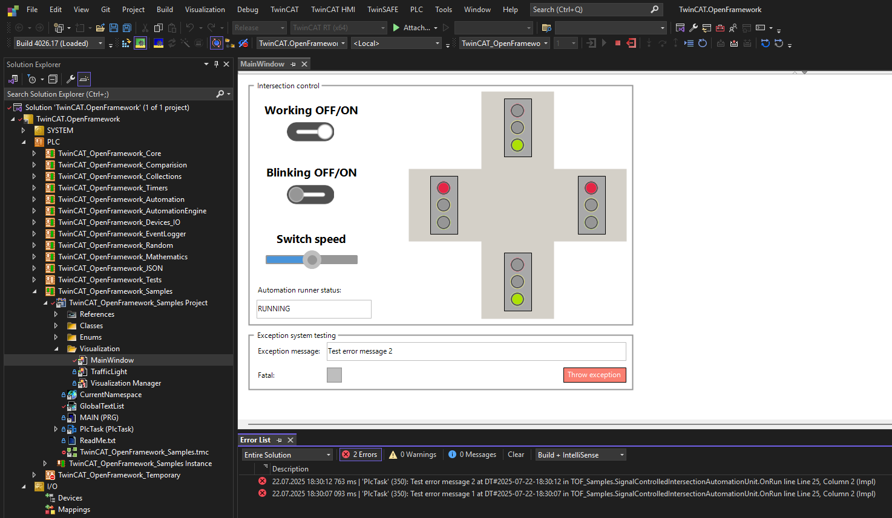
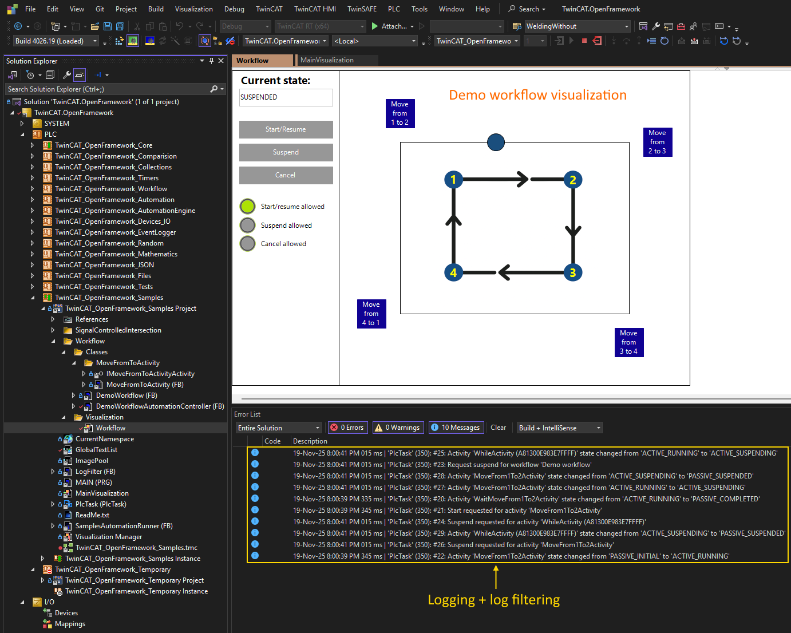
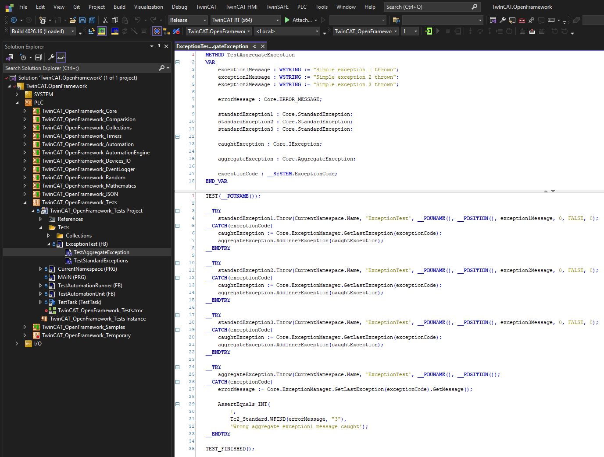

# TwinCAT.OpenFramework: Technical Capabilities

This is an **object-oriented framework** developed for **TwinCAT 3.1 Build 4026+**, providing modular, predictable libraries for industrial automation (current library release: `1.0.12.0`).

It brings modern software tools — ready-to-use data structures, structured error handling, JSON configuration, and built-in PLC unit tests — directly into Structured Text.

---

## 🛠️ Core Capabilities

### 1. Structured Automation Architecture
* **Automation Execution Engine (`TOF_Automation`):** `AutomationRunner` manages root machine components across `INITIALIZING`, `RUNNING`, and `INVALID` states, automatically updating system time (`TOF_Core.System`), running the task's logger, checking the out-of-memory flag, and cleaning up temporary exceptions at the end of every cycle. Machine nodes inherit from `AutomationComponent` (`OPERATIONAL_STATE`: `INITIALIZING`, `WORKING`, `STOPPED`, `INVALID`) through `BranchAutomationComponent` (`AutomationController<N>`, `CompositeAutomationComponent<N>`) and `LeafAutomationComponent` (`InputLeafAutomationComponent`, `OutputLeafAutomationComponent`, `InputOutputLeafAutomationComponent`). *Concept described [here](Concepts/AutomationEngine/AutomationEngine.md).*
* **Machine Hierarchy, Policies & HMI:** Fixed component trees require each child to receive its `Parent` in `FB_init` and appear only once in `Children`. Components can send events up (`BubbleEvent`) or down (`BroadcastEvent`), check permissions before actions (`IActionPermissionPolicy`), choose how a parent reacts to critical child errors (`IChildCriticalErrorHandlingPolicy`: `Ignore`, `SetErrorAndContinue`, `SetErrorAndStop`), support simulation (`ISimulatable`), and keep HMI plugins (`IAutomationControllerPlugin` / `HmiAutomationComponentElement`) active even while a controller is disabled.
* **I/O Separation (`TOF_IOModels` & `TOF_Devices_IO`):** `TwinCAT.OpenFramework.IO.Models` provides plain PLC data structures matching Beckhoff EtherCAT terminal layouts (`EL*`, `EP*`, and `_EX` versions with EtherCAT bus status fields). `TwinCAT.OpenFramework.Devices.IO` wraps digital and analog channels with value scalers (`Direct`, `StaticRange`, `DynamicRange`) so hardware wiring stays separate from machine logic. *See [IO Models Guide](Guides/IOModels.md).*
* **Dynamic Workflow Engine (`TOF_Workflow`):** While `AutomationController` is built for fixed physical machines, `Workflow` runs flexible step-by-step sequences loaded or built at runtime (for example, from JSON recipes). Includes `SequenceActivity`, `WhileActivity` (`Body`), `IfElseActivity`, `WaitAndPickActivity`, `ParallelActivity`, `TryCatchActivity` + `CatchActivity`, `DelayActivity`, `WaitConditionActivity`, `WaitVariableValueActivity`, `AssignVariableActivity`, and `InvokeTaskActivity`, plus scoped variables (`DeclareVariable`, `DeclareArray`, `BindPlcVariable`) and JSON loading/saving via `WorkflowLoader`. *See [Workflow Construction Guide](Guides/WorkflowConstruction.md).*

### 2. Modern Tools for PLC Development
* **Structured Exceptions & Task Diagnostics (`TOF_Core`):** Exceptions carry a textual message (`ERROR_MESSAGE`, default 500 wide chars via `Parameters.ERROR_MESSAGE_WIDE_CHAR_SIZE`), numeric error code, throw/catch locations, local/UTC timestamps, and inner-cause chains. Helper methods in `TOF_Core.Exceptions` (`ThrowStandard`, `ThrowArgumentNotSpecified`, `ThrowArgumentOutOfRange`, `ThrowDataMemberNotSpecified`, `ThrowNullReference`, etc.) save PLC task stack space by creating the temporary exception only when an error actually happens, and format messages directly into fixed buffers without dynamic string builders (you can also call `.Throw()` directly on local or custom exception instances). To keep error details across PLC cycles, copy them into an `ERROR` object. If dynamic memory ever runs out, `DynamicMemoryManager` sets a global flag so the task stops safely at the end of the cycle instead of continuing in a broken state. *Concept described [here](Concepts/Exceptions/ExceptionsConcept.md).*
* **Static & Dynamic Collections (`TOF_Collections` & `TOF_Comparison`):** Ready-to-use containers (`List`, `ByteList`, `Dictionary`, `UniqueDataSet`, `Queue`, `Stack`) that can store any PLC value through `GENERIC_VALUE` (25 `GENERIC_TYPE_CLASS` categories) and compare items using `IComparer`, `IEqualityComparer`, or `GENERIC_VALUE.CompareTo`. Fixed-size mode (`N > 0`) avoids dynamic memory allocation; `no_assign` blocks accidental variable-to-variable copying (`colA := colB`); `List.Sort` can sort numbers, text, times, and objects without writing a custom comparer. *Concepts: [Collections](Concepts/Collections/CollectionsConcept.md), [Generic Values](Concepts/Generics/GenericsConcept.md).*
* **Multi-Cycle Tasks & Timers (`TOF_Tasks` & `TOF_Timers`):** Building blocks for work that spans multiple PLC cycles: `Task` (with a shared `STOPPING` / `OnStopping` shutdown phase before releasing resources, and an optional separate `DiagnosticLogger` to bypass `LogManager` when needed), `TaskQueue` for running tasks one after another, and cyclic `Timer`.
* **JSON & Configuration Loading/Saving (`TOF_JSON` & `TOF_Core`):** `AutomaticJsonSerializer` converts PLC structures to and from JSON automatically (using `IJsonExtender` for custom fields), while `JsonConfigurationReader` and `JsonConfigurationWriter` load and save configurable objects such as `Workflow` through `IConfigurationSerializable`. *Ownership rules: [JSON & EventLogger Guide](Guides/JsonAndEventLoggerOwnership.md).*

### 3. Developer Productivity & Testing Tools
* **String & Wide-String Utilities:** `Strings`, `WideStrings`, `StringBuilder`, `WideStringBuilder`, and truncation helpers (`ConcatFit255`, `AppendFit`, `AnyToStringFit255`) for both `STRING` and `WSTRING` (texts longer than 255 characters are supported via builders).
* **Per-Task Logging (`TOF_Core` & `TOF_Loggers`):** `TOF_Core.LogManager` routes each PLC task's logs (`CurrentTaskLogger`, `ExecuteCurrentTaskLogger`) with topic filters, defaulting to `AdsLogger`. `TOF_Loggers` adds `SimpleTextFileLogger` (fixed 50-slot buffer without allocating memory per message), `EventLogger` (built on `TOF_Core.EventLoggerMessage`), and `QueuedLogger` (safe queue for sharing one log backend across tasks).
* **Non-Blocking File System (`TOF_FileSystem`):** File and directory tasks (`FileContentManager`, `FileHandleResourceManager`, directory/file operations) with clean cancellation and safe shutdown steps before TwinCAT online change. *See [FileSystem Online Change Guide](Guides/FileSystemOnlineChange.md).*
* **Built-In PLC Testing Framework (`TOF_Testing`):** Standalone test runner with `SingleCycleTest`, `MultiCycleTest` (returning `BUSY`/`DONE`), static `TestGroup<N>` / `TestRunner<N>`, 26 typed `Assert.That*` helpers plus generic `AssertionContext`, and output via `AdsReporter` or `JUnitXmlReporter`. *See [Testing Library Guide](Sources/TwinCAT.OpenFramework.Testing/README.md).*

---

## 📦 Solution Projects Overview

| Project (`Sources/`) | Namespace | Role |
|---|---|---|
| `TwinCAT.OpenFramework.Core` | `TOF_Core` | Base `Object`, `GENERIC_VALUE`, `System`, `Exceptions`, `DynamicMemoryManager`, `LogManager`, `EventLoggerMessage`, strings, math, `IConfigurationSerializable` |
| `TwinCAT.OpenFramework.Comparison` | `TOF_Comparison` | Equality and ordering comparers for `GENERIC_VALUE` |
| `TwinCAT.OpenFramework.Collections` | `TOF_Collections` | `List`, `ByteList`, `Dictionary`, `UniqueDataSet`, `Queue`, `Stack`, enumerators |
| `TwinCAT.OpenFramework.Tasks` | `TOF_Tasks` | Multi-cycle `Task`, `TaskQueue`, clean `STOPPING` shutdown |
| `TwinCAT.OpenFramework.Timers` | `TOF_Timers` | Cyclic `Timer` built on `TOF_Tasks` |
| `TwinCAT.OpenFramework.JSON` | `TOF_JSON` | `AutomaticJsonSerializer`, `JsonConfigurationReader`, `JsonConfigurationWriter` |
| `TwinCAT.OpenFramework.FileSystem` | `TOF_FileSystem` | Non-blocking file & directory tasks, `FileContentManager` |
| `TwinCAT.OpenFramework.Loggers` | `TOF_Loggers` | `SimpleTextFileLogger`, `EventLogger`, `QueuedLogger` |
| `TwinCAT.OpenFramework.IO.Models` | `TOF_IOModels` | EtherCAT terminal data layouts matching Beckhoff ESI files |
| `TwinCAT.OpenFramework.Devices.IO` | `TOF_Devices_IO` | `DigitalInput`/`Output`, `AnalogInput`/`Output`, range scalers |
| `TwinCAT.OpenFramework.Automation` | `TOF_Automation` | `AutomationRunner`, `AutomationController`, `Composite`/`Leaf` components, HMI plugin base |
| `TwinCAT.OpenFramework.Workflow` | `TOF_Workflow` | Dynamic step/condition engine, scoped variables, `WorkflowLoader` |
| `TwinCAT.OpenFramework.Testing` | `TOF_Testing` | Native PLC unit-test runner, typed assertions, ADS & JUnit XML reporters |
| `TwinCAT.OpenFramework.HowTo` | `TOF_HowTo` | Minimal standalone learning examples (`IO`, `Testing`) without extra framework dependencies |
| `TwinCAT.OpenFramework.Samples` | `TOF_Samples` | Complete demo applications (`Intersection`, `Workflow`) |
| `TwinCAT.OpenFramework.Tests` | `TOF_Tests` | Automated `TOF_Testing` suites and an independent driver for framework contract tests |

---

## 🚀 Visual Feature Comparison

Compare traditional ST approaches with the framework:
* [Simple string concatenation](Screenshots/FunctionalityComparision/SimpleConcat.png)
* [Long string concatenation](Screenshots/FunctionalityComparision/ConcatLongString.png)
* [Dynamic collections](Screenshots/FunctionalityComparision/List.png)
* [Structured Logging](Screenshots/FunctionalityComparision/Logging.png)
* [Exception Handling](Screenshots/FunctionalityComparision/Exceptions.png)

---

## 🧪 Examples, Guides & Getting Started

1. **`TwinCAT.OpenFramework.HowTo`** — Minimal, standalone runnable examples (such as `IOModelsExample` and `Testing` examples).
2. **`TwinCAT.OpenFramework.Samples`** — Complete application demos with visualization ([Signal-Controlled Intersection Demo](Guides/SignalControlledIntersectionDemo.md) and `DemoWorkflowController`).
3. **`TwinCAT.OpenFramework.Tests`** — Automated regression suites across all libraries.

**To try it out:**
1. Install **TwinCAT 3.1 Build 4026** (XAE).
2. Clone the [TwinCAT.OpenFramework repository](https://github.com/trofimich/TwinCAT.OpenFramework.git).
3. Open `Sources/TwinCAT.OpenFramework.sln`, ensure library placeholders resolve to the solution projects, build, and run `Samples` or `HowTo`.

---

## 📈 Roadmap & Community

Active development focuses on:
* Resolving remaining `Devices.IO` diagnostic/converter edge cases and expanding `HowTo` examples (`FileSystem`, `Tasks`, `Collections`, `Exceptions`, `JSON`).
* Expanding industrial device abstractions with `ISimulatable` support (valves, cylinders, drives, `Tc2_MC2` axes) and `TwinCAT HMI` integration.

**Want to contribute?**
Open an issue or pull request on GitHub with architectural ideas, bug reports, or improvements.

---

## 💡 Technical Notes

**Why do framework classes extend `Object`?**
Structured Text does not have a built-in base class like `Object` in C# or Java. Extending `TOF_Core.Object` gives classes a shared way to check equality (`Equals`, `GetHashCode`), report type info (`ClassName` in `VAR_STAT`, `NamespaceName`, `SelfSize`), and run `FB_exit` safely when dynamic objects are freed through `TOF_Core.Memory.TryReleaseDynamicObject`.

---

## 🖼️ Screenshots

*(Visualizations of Signal-Controlled Intersection, Workflow Engine, Collections, and File Manager)*

